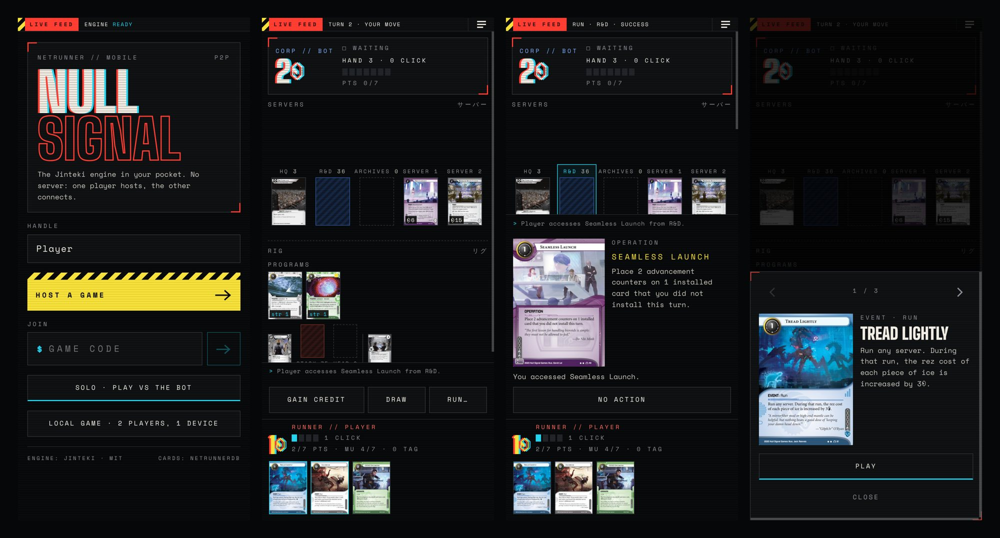
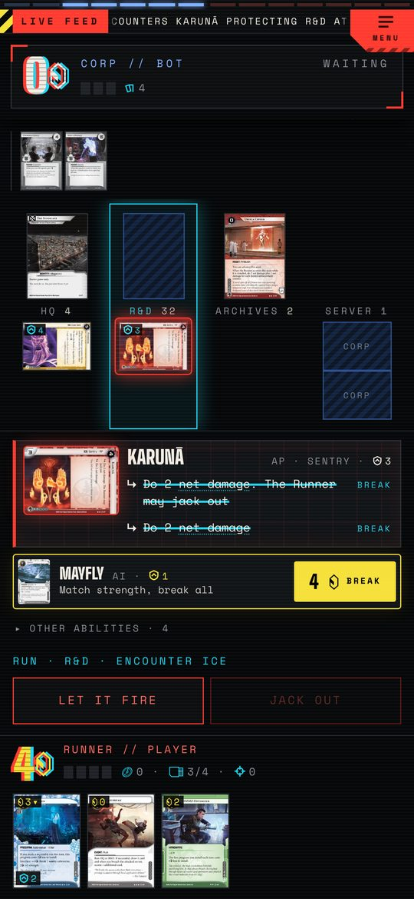
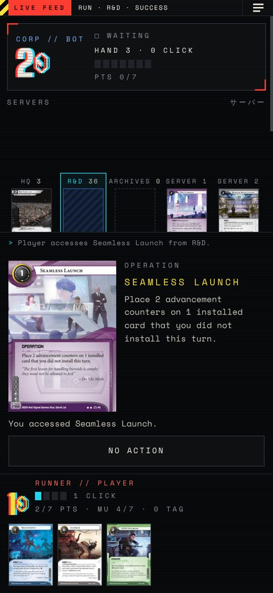
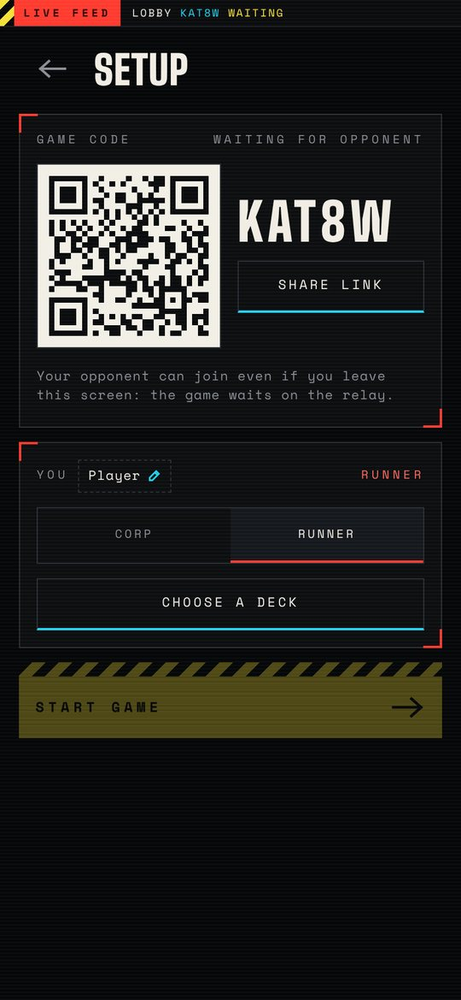
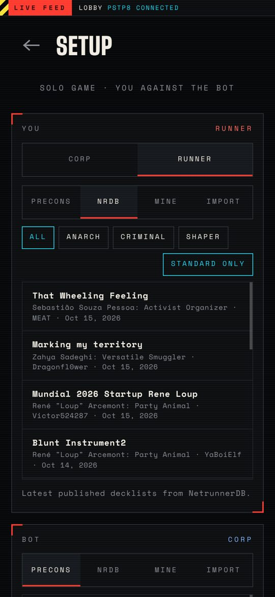
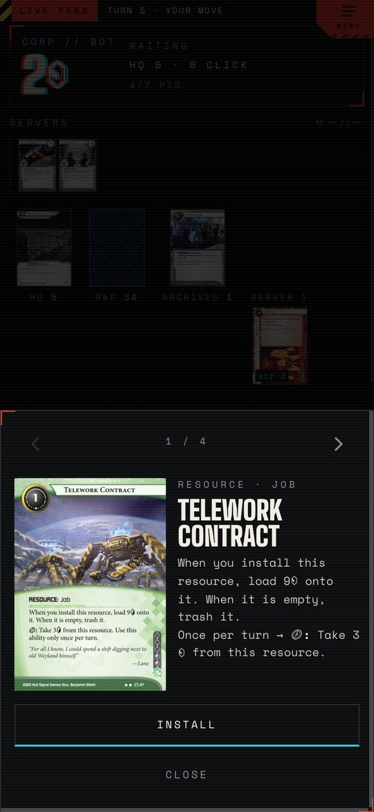
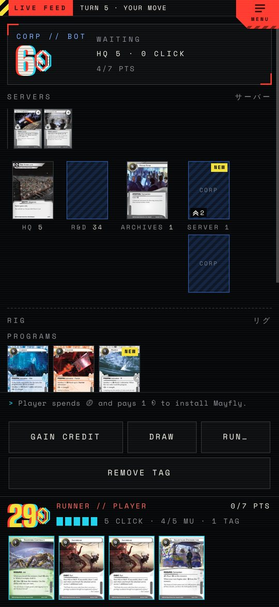

# Netrunner mobile

A phone-first way to play Netrunner online, built on the [Jinteki.net](https://github.com/mtgred/netrunner)
rules engine and running entirely in the browser. Both phones run the engine and replay the
same ordered list of actions, relayed by a small Cloudflare Durable Object (free plan), so
either player can leave and come back without stopping the game.

**Play: <https://lelongg.github.io/netrunner/>** (installable as an app, works offline for
solo and local games)



Unofficial fan project, not affiliated with or endorsed by Null Signal Games or the
Jinteki.net team.

## Features

- **Online play without a game server.** Host a game, share the code, the invite link or the
  QR code, and your opponent joins from their own phone. Games go through a Cloudflare relay
  that only orders and stores actions (see [`relay/`](../relay)); without one the app falls
  back to a direct WebRTC link matched through public Nostr relays with
  [Trystero](https://github.com/dmotz/trystero).
- **Solo against a bot.** A heuristic bot plays either side from its own view of the game,
  without peeking at hidden cards.
- **Local hot-seat.** Two players on one device, with a privacy screen whenever the device
  changes hands (mulligans, end of turn, opponent decisions during a run).
- **Decks.** System Gateway starters, the Classique and Worlds decks shipped with Jinteki,
  the latest published decklists from NetrunnerDB (filter by faction, Standard only), or
  import any NetrunnerDB link or text decklist. Deck viewer with list and card views.
- **The full Jinteki engine.** Every card Jinteki implements, with the same rules,
  prompts, runs and priority windows.
- **Built for phones.** Your view is laid out from your seat (the opponent's outermost ice
  is closest to you), tap a card for its text and actions, swipe through a server, hand or
  pile, tap the image for a full-screen high-resolution scan, Android back closes overlays.
- **Survives real life.** Reloading resumes the game and switching apps reconnects
  automatically. With the relay, either player can close the app mid-game; the other keeps
  playing and the absent one catches up when they return.
- **Undo a click** that revealed nothing: no draws, accesses or runs, no opponent action in
  between, one click at a time.

| | | |
|---|---|---|
|  |  |  |
| A run in progress | Accessing a card | Hosting with a QR code |
|  |  |  |
| NetrunnerDB decklists | Card sheet | Board from the Runner's seat |

## How it works

```
┌──── phone (seat 0) ────┐                                  ┌──── phone (seat 1) ────┐
│ Preact UI              │   append ┌──────────────────┐    │ Preact UI              │
│ Session ── engine ◄────┼──────────┤ Cloudflare relay ├────┼──► engine ── Session   │
│ (replays the log)      │  entries │ GameRoom (DO,    │    │ (replays the log)      │
└────────────────────────┘ (seq #)  │ SQLite log)      │    └────────────────────────┘
                                    └──────────────────┘
```

- **Engine.** Jinteki's `src/clj/game/**` sources were converted to `.cljc` with reader
  conditionals and compile to an ES module with shadow-cljs (`:engine` build, entry point
  `src/cljs/engine/api.cljs`). The JS API: `loadCards`, `createGame`,
  `act(game, side, command, args)`, `view(game, side)`, `say`, `concede`, `renderMessage`,
  `loadDictionary`, `precons`. The JVM test suite still runs against the same sources.
- **Shared log.** Lobby choices (names, side, decks, ready) and every game command are
  payloads appended to one ordered log. The relay gives each a sequence number and the
  sender's seat; each phone applies entries strictly in order, ignoring anything invalid the
  same way on both sides, and the `start` entry carries the random seed. Since the engine is
  deterministic under that seed, both phones hold the same game. Unacknowledged payloads are
  kept in an outbox and resent after a reconnection has replayed what was missed, so nothing
  is applied twice. `src/net/relay.ts` talks to the relay; `src/net/p2p.ts` implements the
  same contract over WebRTC with the host's phone as the sequencer.
- **Hidden information.** Each phone runs the full game, so a determined player could read
  the opponent's hand from the browser's memory. Play with people you trust.
- **Commands.** The same as Jinteki's web client (`play`, `ability`, `choice`, `select`,
  `run`, `continue`…). Per-card actions, prompts and run buttons follow
  `src/cljs/nr/gameboard/board.cljs`.
- **Cards.** `scripts/build-cards.mjs` downloads `raw_data.edn` from
  [NoahTheDuke/netrunner-data](https://github.com/NoahTheDuke/netrunner-data) and writes
  `public/data/cards.json`. Card images and decklists come from
  [NetrunnerDB](https://netrunnerdb.com).

### Saving and resuming

The engine state holds functions and cannot be serialised, so games are stored as logs:
online games keep the shared log (`localStorage`, key `nsg.online`, refreshed from the relay
on reconnect), solo and local games the setup, a random seed and every action (key
`nsg.save`). During
each engine call `Math.random` is swapped for an `sfc32` generator seeded from the log, so
replaying it reproduces the same game: shuffles, choice ids and all. The smoke test checks
that a replay yields identical views.

### The bot

`src/bot/heuristic.ts` plays from **its own view** only and picks among the legal moves
computed by `src/game/actions.ts`. As Corp it scores and advances agendas behind ice, keeps
its economy going and rezzes ice on approach. As Runner it builds economy, installs missing
breakers and runs the most valuable server it expects to get into, keeping enough cards to
survive damage. It is a fair Corp and a weak Runner.

```sh
node --experimental-strip-types scripts/bot-eval.mjs 20 bot-vs-random 0   # 20 games, beginner decks
node --experimental-strip-types scripts/bot-eval.mjs 20 bot-vs-bot 1      # intermediate decks
```

`scripts/fuzz.mjs` plays random legal moves to hunt for engine errors and dead-end prompts.

## Development

Requirements: Java 17+, [Leiningen](https://leiningen.org), Node 20+.

```sh
npm ci                 # at the repository root (shadow-cljs)
cd mobile && npm ci
npm run engine         # compile the engine (dev) → mobile/engine/
npm run cards          # cards and translations → mobile/public/
npm run smoke          # scripted game under Node
npm run dev            # http://localhost:5173
```

`npm run engine:release` builds the optimised engine (about 3 MB, 690 KB gzipped).

To test with two phones on your network, run `npm run dev -- --host` and open the printed
address on both. WebRTC needs HTTPS outside `localhost`, so use the deployed version or an
HTTPS tunnel.

## Deployment

`.github/workflows/mobile.yml` builds the engine and the app, runs the smoke test and
publishes `mobile/dist` to GitHub Pages on every push to `master` (set *Settings → Pages →
Source* to *GitHub Actions*). Any static host works.

Online games use the relay whose URL is baked in at build time as `VITE_RELAY_URL`, set in
`mobile/.env.production`. Deploying it takes a free Cloudflare
account and one `wrangler deploy`: see [`relay/README.md`](../relay/README.md).

Without a relay URL the app falls back to peer-to-peer links. Matchmaking then goes through [Trystero](https://github.com/dmotz/trystero) over several
public Nostr relays at once, so no account or server is needed and no single relay is a
point of failure. The relays only carry the encrypted connection offers; game data flows
directly between the phones. The room is the game code (`APP_ID` in `src/net/p2p.ts`
namespaces it), and the host's phone orders the log, so it must stay online. Trystero can also use MQTT brokers, BitTorrent trackers or a self-hosted
WebSocket relay by changing the import.

Phones find their public address with Cloudflare's and Google's free STUN servers. Some
mobile networks still block direct links and need a TURN relay, which you can provide at
build time with
`VITE_ICE_SERVERS`, a JSON array of
[ICE servers](https://developer.mozilla.org/en-US/docs/Web/API/RTCIceServer) (free tiers
exist at Cloudflare Calls and Metered, for example). The deploy workflow reads it from an
optional `ICE_SERVERS` repository secret. These credentials end up in the public bundle,
so use ones meant for browsers.

## Known limitations

- No cheating protection: each phone runs the full game state. Play with people you trust.
- One saved game per device: starting a new game replaces the previous one.
- English only.
- Card support is whatever the Jinteki engine implements; the newest cards may be missing.
- In the peer-to-peer fallback, the host must keep the app open and, without a TURN relay,
  some mobile networks cannot connect at all (the join screen says so).
- A relayed game is deleted after 14 days without activity.

## Credits

- Rules engine, card implementations, game symbol font and precon decks:
  [Jinteki.net](https://github.com/mtgred/netrunner) contributors (MIT).
- Card data: [netrunner-data](https://github.com/NoahTheDuke/netrunner-data).
- Card images and decklists: [NetrunnerDB](https://netrunnerdb.com).
- Netrunner is published by [Null Signal Games](https://nullsignal.games). Card names, text
  and art belong to their respective owners.
- Fonts: Big Shoulders Display and Space Mono (SIL Open Font License).
- Peer-to-peer matchmaking: [Trystero](https://github.com/dmotz/trystero).
